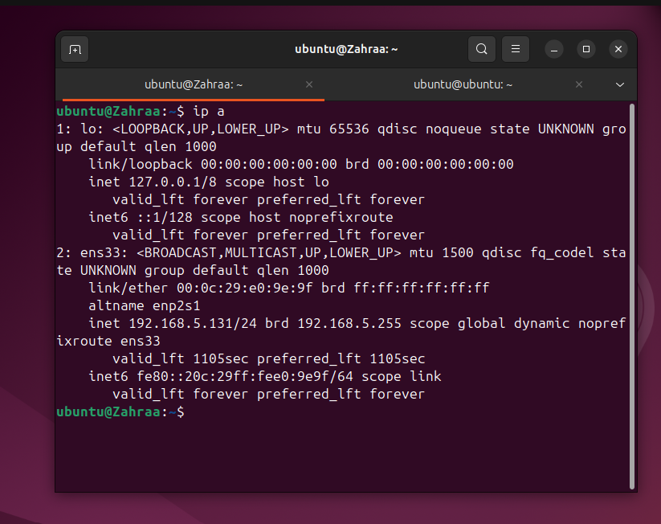
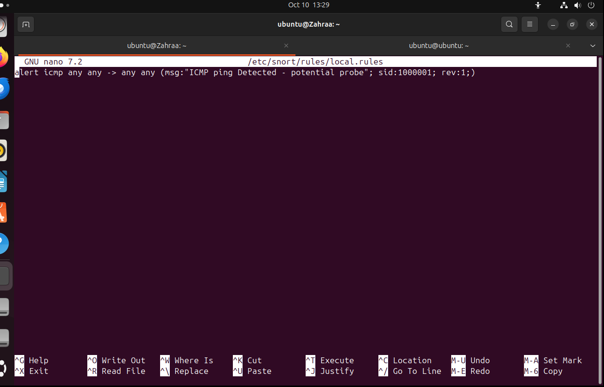
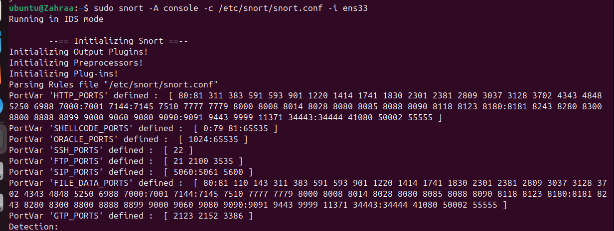

# Network Intrusion Detection System (NIDS) - CodeAlpha Task 4

This repository contains the setup, configuration, and implementation documentation for Task 4 of the CodeAlpha Cybersecurity Internship Program. The project focuses on deploying a Network-based Intrusion Detection System using **Snort** to monitor live network traffic and detect potential threats in real time[cite: 6].

---

## 🚀 Project Overview

The main objective of this project is to configure an intrusion detection environment on an Ubuntu system, define custom security rules to intercept malicious or suspicious patterns, and validate threat alerts dynamically.

### Key Implementation Steps:
1. **Network Interface Identification:** Inspected active network adapters using `ip a` to designate the primary monitoring interface (`ens33`).
2. **Custom Rule Development:** Configured local security rules (`local.rules`) to detect specific network probes, such as ICMP traffic packets.
3. **Continuous Traffic Monitoring:** Launched Snort in silent listening mode waiting for incoming traffic matches.
4. **Real-time Detection & Alerting:** Triggered an ICMP request (`ping 8.8.8.8`), which Snort immediately captured and flagged with real-time console alerts.

---

## 📸 Demonstration & Screenshots

### 1. Identifying Network Interface
Inspecting active network interfaces to find the default adapter name (`ens33`):


### 2. Custom Snort Rule Configuration
Defining the custom ICMP detection rule inside `/etc/snort/rules/local.rules`:


### 3. Snort Listening Mode (Pre-Attack)
Snort running actively in the background, listening on interface `ens33` without triggering false alerts prior to traffic generation:



### 4. Real-time Intrusion Alert (Post-Ping)
Executing `ping 8.8.8.8` from another terminal session and observing instant real-time alerts in the Snort console:


---

## 🛠️ Tools & Technologies Used
- **Snort:** Open-source Network Intrusion Detection System (NIDS)[cite: 6].
- **Ubuntu Linux:** Operating system environment and CLI.
- **Git & GitHub:** Version control and project documentation[cite: 6].

---

## ⚙️ Configuration & Execution

1. **Check Network Interface:**
   ```bash
   ip a
